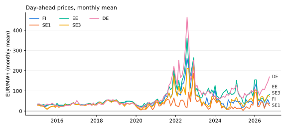

# Check report 01_fetch: Download day-ahead prices

Written by `code/01_fetch.py`. Rerun with `python run_all.py --steps 01`.

Day-ahead prices for FI, SE1, SE3, EE, DE from the ENTSO-E Transparency Platform (https://transparency.entsoe.eu), one CSV file per zone and calendar year (Helsinki time) in `data/raw/`. Prices in EUR/MWh.

## Download settings (fixed, not choices)

| setting | value |
|---|---|
| zones | FI, SE1, SE3, EE, DE |
| DE | DE-AT-LU until 2018-09-30, DE-LU from 2018-10-01 (zone change at midnight Berlin time) |
| period | 2015-01-01 up to (not including) 2026-11-01 |
| files | one per zone and calendar year in Helsinki time |
| 15-minute prices from | 2025-10-01 01:00 Helsinki (= 2025-09-30 22:00 UTC) |
| time-out per request | 120 s |
| retries | network errors, time-outs, HTTP 5xx: after 10 s, 30 s, 60 s, 120 s, 300 s; HTTP 429: after 660 s |

This step reads no analysis choices: it downloads everything any choice can select. A file already in `data/raw/` is not downloaded again (delete it to get a fresh copy). Which files were downloaded in this run, and any retries, are printed in the terminal, not here, so this report changes only when the data changes.

## Summary

| what | value |
|---|---|
| files expected | 60 |
| files present | 60 |
| no data at ENTSO-E | 0 |
| FAILED | 0 |
| rows in all files | 661103 |
| size of all files | 37.0 MB |

## Files: rows

EXPECT: rows = expected (8760 hours a year, 8784 in leap years; 2025 mixes hours and quarter-hours; 2026 has quarter-hours), and 0 missing, 0 extra, 0 duplicates, 0 empty prices.

| file | status | rows | expected | missing | extra | duplicates | empty prices | 60-min rows | 15-min rows |
|---|---|---|---|---|---|---|---|---|---|
| prices_FI_2015.csv | present | 8760 | 8760 | 0 | 0 | 0 | 0 | 8760 | 0 |
| prices_FI_2016.csv | present | 8784 | 8784 | 0 | 0 | 0 | 0 | 8784 | 0 |
| prices_FI_2017.csv | present | 8760 | 8760 | 0 | 0 | 0 | 0 | 8760 | 0 |
| prices_FI_2018.csv | present | 8760 | 8760 | 0 | 0 | 0 | 0 | 8760 | 0 |
| prices_FI_2019.csv | present | 8760 | 8760 | 0 | 0 | 0 | 0 | 8760 | 0 |
| prices_FI_2020.csv | present | 8784 | 8784 | 0 | 0 | 0 | 0 | 8784 | 0 |
| prices_FI_2021.csv | present | 8760 | 8760 | 0 | 0 | 0 | 0 | 8760 | 0 |
| prices_FI_2022.csv | present | 8760 | 8760 | 0 | 0 | 0 | 0 | 8760 | 0 |
| prices_FI_2023.csv | present | 8760 | 8760 | 0 | 0 | 0 | 0 | 8760 | 0 |
| prices_FI_2024.csv | present | 8784 | 8784 | 0 | 0 | 0 | 0 | 8784 | 0 |
| prices_FI_2025.csv | present | 15384 | 15384 | 0 | 0 | 0 | 0 | 6552 | 8832 |
| prices_FI_2026.csv | present | 29184 | 29184 | 0 | 0 | 0 | 0 | 0 | 29184 |
| prices_SE1_2015.csv | present | 8760 | 8760 | 0 | 0 | 0 | 0 | 8760 | 0 |
| prices_SE1_2016.csv | present | 8784 | 8784 | 0 | 0 | 0 | 0 | 8784 | 0 |
| prices_SE1_2017.csv | present | 8760 | 8760 | 0 | 0 | 0 | 0 | 8760 | 0 |
| prices_SE1_2018.csv | present | 8760 | 8760 | 0 | 0 | 0 | 0 | 8760 | 0 |
| prices_SE1_2019.csv | present | 8760 | 8760 | 0 | 0 | 0 | 0 | 8760 | 0 |
| prices_SE1_2020.csv | present | 8784 | 8784 | 0 | 0 | 0 | 0 | 8784 | 0 |
| prices_SE1_2021.csv | present | 8760 | 8760 | 0 | 0 | 0 | 0 | 8760 | 0 |
| prices_SE1_2022.csv | present | 8760 | 8760 | 0 | 0 | 0 | 0 | 8760 | 0 |
| prices_SE1_2023.csv | present | 8760 | 8760 | 0 | 0 | 0 | 0 | 8760 | 0 |
| prices_SE1_2024.csv | present | 8784 | 8784 | 0 | 0 | 0 | 0 | 8784 | 0 |
| prices_SE1_2025.csv | present | 15384 | 15384 | 0 | 0 | 0 | 0 | 6552 | 8832 |
| prices_SE1_2026.csv | present | 29184 | 29184 | 0 | 0 | 0 | 0 | 0 | 29184 |
| prices_SE3_2015.csv | present | 8760 | 8760 | 0 | 0 | 0 | 0 | 8760 | 0 |
| prices_SE3_2016.csv | present | 8784 | 8784 | 0 | 0 | 0 | 0 | 8784 | 0 |
| prices_SE3_2017.csv | present | 8760 | 8760 | 0 | 0 | 0 | 0 | 8760 | 0 |
| prices_SE3_2018.csv | present | 8760 | 8760 | 0 | 0 | 0 | 0 | 8760 | 0 |
| prices_SE3_2019.csv | present | 8760 | 8760 | 0 | 0 | 0 | 0 | 8760 | 0 |
| prices_SE3_2020.csv | present | 8784 | 8784 | 0 | 0 | 0 | 0 | 8784 | 0 |
| prices_SE3_2021.csv | present | 8760 | 8760 | 0 | 0 | 0 | 0 | 8760 | 0 |
| prices_SE3_2022.csv | present | 8760 | 8760 | 0 | 0 | 0 | 0 | 8760 | 0 |
| prices_SE3_2023.csv | present | 8760 | 8760 | 0 | 0 | 0 | 0 | 8760 | 0 |
| prices_SE3_2024.csv | present | 8784 | 8784 | 0 | 0 | 0 | 0 | 8784 | 0 |
| prices_SE3_2025.csv | present | 15384 | 15384 | 0 | 0 | 0 | 0 | 6552 | 8832 |
| prices_SE3_2026.csv | present | 29184 | 29184 | 0 | 0 | 0 | 0 | 0 | 29184 |
| prices_EE_2015.csv | present | 8760 | 8760 | 0 | 0 | 0 | 0 | 8760 | 0 |
| prices_EE_2016.csv | present | 8784 | 8784 | 0 | 0 | 0 | 0 | 8784 | 0 |
| prices_EE_2017.csv | present | 8760 | 8760 | 0 | 0 | 0 | 0 | 8760 | 0 |
| prices_EE_2018.csv | present | 8760 | 8760 | 0 | 0 | 0 | 0 | 8760 | 0 |
| prices_EE_2019.csv | present | 8760 | 8760 | 0 | 0 | 0 | 0 | 8760 | 0 |
| prices_EE_2020.csv | present | 8784 | 8784 | 0 | 0 | 0 | 0 | 8784 | 0 |
| prices_EE_2021.csv | present | 8760 | 8760 | 0 | 0 | 0 | 0 | 8760 | 0 |
| prices_EE_2022.csv | present | 8760 | 8760 | 0 | 0 | 0 | 0 | 8760 | 0 |
| prices_EE_2023.csv | present | 8760 | 8760 | 0 | 0 | 0 | 0 | 8760 | 0 |
| prices_EE_2024.csv | present | 8784 | 8784 | 0 | 0 | 0 | 0 | 8784 | 0 |
| prices_EE_2025.csv | present | 15384 | 15384 | 0 | 0 | 0 | 0 | 6552 | 8832 |
| prices_EE_2026.csv | present | 29184 | 29184 | 0 | 0 | 0 | 0 | 0 | 29184 |
| prices_DE_2015.csv | present | 8663 | 8760 | 97 | 0 | 0 | 0 | 8663 | 0 |
| prices_DE_2016.csv | present | 8784 | 8784 | 0 | 0 | 0 | 0 | 8784 | 0 |
| prices_DE_2017.csv | present | 8760 | 8760 | 0 | 0 | 0 | 0 | 8760 | 0 |
| prices_DE_2018.csv | present | 8760 | 8760 | 0 | 0 | 0 | 0 | 8760 | 0 |
| prices_DE_2019.csv | present | 8760 | 8760 | 0 | 0 | 0 | 0 | 8760 | 0 |
| prices_DE_2020.csv | present | 8784 | 8784 | 0 | 0 | 0 | 0 | 8784 | 0 |
| prices_DE_2021.csv | present | 8760 | 8760 | 0 | 0 | 0 | 0 | 8760 | 0 |
| prices_DE_2022.csv | present | 8760 | 8760 | 0 | 0 | 0 | 0 | 8760 | 0 |
| prices_DE_2023.csv | present | 8760 | 8760 | 0 | 0 | 0 | 0 | 8760 | 0 |
| prices_DE_2024.csv | present | 8784 | 8784 | 0 | 0 | 0 | 0 | 8784 | 0 |
| prices_DE_2025.csv | present | 15384 | 15384 | 0 | 0 | 0 | 0 | 6552 | 8832 |
| prices_DE_2026.csv | present | 29184 | 29184 | 0 | 0 | 0 | 0 | 0 | 29184 |

## Files: prices (EUR/MWh)

EXPECT: no price below -500, the market's minimum price.

| file | min | mean | max | negative rows | below -500 |
|---|---|---|---|---|---|
| prices_FI_2015.csv | 0.32 | 29.66 | 150.06 | 0 | 0 |
| prices_FI_2016.csv | 4.02 | 32.45 | 214.25 | 0 | 0 |
| prices_FI_2017.csv | 2.99 | 33.19 | 130.05 | 0 | 0 |
| prices_FI_2018.csv | 1.59 | 46.80 | 255.02 | 0 | 0 |
| prices_FI_2019.csv | 0.12 | 44.04 | 199.98 | 0 | 0 |
| prices_FI_2020.csv | -1.73 | 28.02 | 254.44 | 9 | 0 |
| prices_FI_2021.csv | -1.41 | 72.34 | 1000.07 | 5 | 0 |
| prices_FI_2022.csv | -2.08 | 154.04 | 861.14 | 27 | 0 |
| prices_FI_2023.csv | -500.00 | 56.46 | 777.18 | 467 | 0 |
| prices_FI_2024.csv | -20.01 | 45.57 | 1896.00 | 725 | 0 |
| prices_FI_2025.csv | -21.39 | 42.09 | 572.20 | 596 | 0 |
| prices_FI_2026.csv | -10.92 | 57.46 | 654.88 | 225 | 0 |
| prices_SE1_2015.csv | 0.32 | 21.17 | 66.90 | 0 | 0 |
| prices_SE1_2016.csv | 4.02 | 28.95 | 214.25 | 0 | 0 |
| prices_SE1_2017.csv | 1.70 | 30.84 | 120.01 | 0 | 0 |
| prices_SE1_2018.csv | 1.59 | 44.23 | 255.02 | 0 | 0 |
| prices_SE1_2019.csv | 0.12 | 37.94 | 107.67 | 0 | 0 |
| prices_SE1_2020.csv | -1.73 | 14.39 | 189.25 | 9 | 0 |
| prices_SE1_2021.csv | -1.97 | 42.49 | 360.00 | 12 | 0 |
| prices_SE1_2022.csv | -2.08 | 59.06 | 590.00 | 29 | 0 |
| prices_SE1_2023.csv | -60.04 | 39.97 | 332.00 | 434 | 0 |
| prices_SE1_2024.csv | -48.69 | 25.06 | 526.25 | 627 | 0 |
| prices_SE1_2025.csv | -94.59 | 20.32 | 275.19 | 727 | 0 |
| prices_SE1_2026.csv | -29.49 | 42.69 | 417.76 | 287 | 0 |
| prices_SE3_2015.csv | 0.32 | 22.01 | 150.06 | 0 | 0 |
| prices_SE3_2016.csv | 4.02 | 29.23 | 214.25 | 0 | 0 |
| prices_SE3_2017.csv | 1.70 | 31.24 | 130.05 | 0 | 0 |
| prices_SE3_2018.csv | 1.59 | 44.54 | 255.02 | 0 | 0 |
| prices_SE3_2019.csv | 0.12 | 38.36 | 109.45 | 0 | 0 |
| prices_SE3_2020.csv | -1.73 | 21.19 | 254.44 | 9 | 0 |
| prices_SE3_2021.csv | -1.97 | 66.00 | 626.06 | 12 | 0 |
| prices_SE3_2022.csv | -2.08 | 129.21 | 799.97 | 29 | 0 |
| prices_SE3_2023.csv | -60.04 | 51.70 | 332.00 | 429 | 0 |
| prices_SE3_2024.csv | -59.96 | 35.77 | 707.52 | 652 | 0 |
| prices_SE3_2025.csv | -25.05 | 50.39 | 518.28 | 507 | 0 |
| prices_SE3_2026.csv | -14.49 | 71.09 | 486.96 | 362 | 0 |
| prices_EE_2015.csv | 0.32 | 31.09 | 150.06 | 0 | 0 |
| prices_EE_2016.csv | 4.02 | 33.06 | 200.06 | 0 | 0 |
| prices_EE_2017.csv | 2.99 | 33.20 | 130.05 | 0 | 0 |
| prices_EE_2018.csv | 1.59 | 47.07 | 255.02 | 0 | 0 |
| prices_EE_2019.csv | 0.12 | 45.86 | 200.03 | 0 | 0 |
| prices_EE_2020.csv | -1.73 | 33.69 | 255.03 | 5 | 0 |
| prices_EE_2021.csv | -1.41 | 86.72 | 1000.07 | 5 | 0 |
| prices_EE_2022.csv | -0.04 | 192.82 | 4000.00 | 2 | 0 |
| prices_EE_2023.csv | -60.04 | 90.78 | 777.18 | 129 | 0 |
| prices_EE_2024.csv | -19.96 | 87.27 | 1896.00 | 183 | 0 |
| prices_EE_2025.csv | -21.71 | 82.94 | 1051.32 | 264 | 0 |
| prices_EE_2026.csv | -10.92 | 80.37 | 847.02 | 180 | 0 |
| prices_DE_2015.csv | -79.94 | 31.83 | 99.77 | 110 | 0 |
| prices_DE_2016.csv | -130.09 | 28.98 | 104.96 | 97 | 0 |
| prices_DE_2017.csv | -83.06 | 34.19 | 163.52 | 145 | 0 |
| prices_DE_2018.csv | -76.01 | 44.47 | 128.26 | 135 | 0 |
| prices_DE_2019.csv | -90.01 | 37.67 | 121.46 | 211 | 0 |
| prices_DE_2020.csv | -83.94 | 30.47 | 200.04 | 298 | 0 |
| prices_DE_2021.csv | -69.00 | 96.86 | 620.00 | 139 | 0 |
| prices_DE_2022.csv | -19.04 | 235.45 | 871.00 | 68 | 0 |
| prices_DE_2023.csv | -500.00 | 95.18 | 524.27 | 302 | 0 |
| prices_DE_2024.csv | -135.45 | 78.51 | 936.28 | 457 | 0 |
| prices_DE_2025.csv | -250.32 | 90.97 | 583.40 | 724 | 0 |
| prices_DE_2026.csv | -499.99 | 113.98 | 747.10 | 1860 | 0 |

## Days with an unexpected number of rows

5 day(s). EXPECT: none. The first 20:

| file | day (Helsinki) | expected rows | seen rows |
|---|---|---|---|
| prices_DE_2015.csv | 2015-01-01 | 24 | 0 |
| prices_DE_2015.csv | 2015-01-02 | 24 | 0 |
| prices_DE_2015.csv | 2015-01-03 | 24 | 0 |
| prices_DE_2015.csv | 2015-01-04 | 24 | 0 |
| prices_DE_2015.csv | 2015-01-05 | 24 | 23 |

## Daylight saving days (FI)

EXPECT: 23 hours in spring and 25 in autumn, so 23 or 25 rows; after the switch to 15 minutes, 92 or 100 rows.

| day | hours | expected rows | seen rows |
|---|---|---|---|
| 2015-03-29 | 23 | 23 | 23 |
| 2015-10-25 | 25 | 25 | 25 |
| 2016-03-27 | 23 | 23 | 23 |
| 2016-10-30 | 25 | 25 | 25 |
| 2017-03-26 | 23 | 23 | 23 |
| 2017-10-29 | 25 | 25 | 25 |
| 2018-03-25 | 23 | 23 | 23 |
| 2018-10-28 | 25 | 25 | 25 |
| 2019-03-31 | 23 | 23 | 23 |
| 2019-10-27 | 25 | 25 | 25 |
| 2020-03-29 | 23 | 23 | 23 |
| 2020-10-25 | 25 | 25 | 25 |
| 2021-03-28 | 23 | 23 | 23 |
| 2021-10-31 | 25 | 25 | 25 |
| 2022-03-27 | 23 | 23 | 23 |
| 2022-10-30 | 25 | 25 | 25 |
| 2023-03-26 | 23 | 23 | 23 |
| 2023-10-29 | 25 | 25 | 25 |
| 2024-03-31 | 23 | 23 | 23 |
| 2024-10-27 | 25 | 25 | 25 |
| 2025-03-30 | 23 | 23 | 23 |
| 2025-10-26 | 25 | 100 | 100 |
| 2026-03-29 | 23 | 92 | 92 |
| 2026-10-25 | 25 | 100 | 100 |

## Excerpts

First rows of `prices_FI_2015.csv`:

| time_utc | time_helsinki | price_eur_mwh | minutes |
|---|---|---|---|
| 2014-12-31T22:00:00Z | 2015-01-01T00:00:00+02:00 | 28.02 | 60 |
| 2014-12-31T23:00:00Z | 2015-01-01T01:00:00+02:00 | 27.38 | 60 |
| 2015-01-01T00:00:00Z | 2015-01-01T02:00:00+02:00 | 23.37 | 60 |
| 2015-01-01T01:00:00Z | 2015-01-01T03:00:00+02:00 | 19.33 | 60 |

The switch to 15 minutes in `prices_FI_2025.csv` (EXPECT: hourly rows until 00:00, quarter-hours from 01:00 Helsinki):

| time_utc | time_helsinki | price_eur_mwh | minutes |
|---|---|---|---|
| 2025-09-30T20:00:00Z | 2025-09-30T23:00:00+03:00 | 61.50 | 60 |
| 2025-09-30T21:00:00Z | 2025-10-01T00:00:00+03:00 | 41.57 | 60 |
| 2025-09-30T22:00:00Z | 2025-10-01T01:00:00+03:00 | 37.65 | 15 |
| 2025-09-30T22:15:00Z | 2025-10-01T01:15:00+03:00 | 34.00 | 15 |
| 2025-09-30T22:30:00Z | 2025-10-01T01:30:00+03:00 | 32.65 | 15 |
| 2025-09-30T22:45:00Z | 2025-10-01T01:45:00+03:00 | 32.42 | 15 |

The autumn daylight saving night 2025-10-26 (EXPECT: the hour 03:00-04:00 Helsinki twice, first +03:00, then +02:00):

| time_utc | time_helsinki | price_eur_mwh | minutes |
|---|---|---|---|
| 2025-10-25T23:45:00Z | 2025-10-26T02:45:00+03:00 | 2.82 | 15 |
| 2025-10-26T00:00:00Z | 2025-10-26T03:00:00+03:00 | 3.08 | 15 |
| 2025-10-26T00:15:00Z | 2025-10-26T03:15:00+03:00 | 2.79 | 15 |
| 2025-10-26T00:30:00Z | 2025-10-26T03:30:00+03:00 | 2.60 | 15 |
| 2025-10-26T00:45:00Z | 2025-10-26T03:45:00+03:00 | 2.18 | 15 |
| 2025-10-26T01:00:00Z | 2025-10-26T03:00:00+02:00 | 2.54 | 15 |
| 2025-10-26T01:15:00Z | 2025-10-26T03:15:00+02:00 | 2.26 | 15 |
| 2025-10-26T01:30:00Z | 2025-10-26T03:30:00+02:00 | 2.01 | 15 |
| 2025-10-26T01:45:00Z | 2025-10-26T03:45:00+02:00 | 1.26 | 15 |
| 2025-10-26T02:00:00Z | 2025-10-26T04:00:00+02:00 | 1.42 | 15 |

The German zone change in `prices_DE_2018.csv`: DE-AT-LU until 00:00 Berlin time, DE-LU after; the row at 2018-10-01 01:00 Helsinki (22:00 UTC) is the first DE-LU row. EXPECT: no gap, no double row, no jump in prices.

| time_utc | time_helsinki | price_eur_mwh | minutes |
|---|---|---|---|
| 2018-09-30T20:00:00Z | 2018-09-30T23:00:00+03:00 | 65.08 | 60 |
| 2018-09-30T21:00:00Z | 2018-10-01T00:00:00+03:00 | 60.87 | 60 |
| 2018-09-30T22:00:00Z | 2018-10-01T01:00:00+03:00 | 59.53 | 60 |
| 2018-09-30T23:00:00Z | 2018-10-01T02:00:00+03:00 | 56.10 | 60 |

## Facts to recognise: EXPECT next to SEE

| EXPECT | SEE |
|---|---|
| FI: highest yearly mean price in 2022 (energy crisis) | highest: 2022 (154.04 EUR/MWh) |
| FI 2023-11-24: many hours at -500 (a trader's erroneous bid) | 9 rows at -500; day mean -181.52 |
| FI: hours with a negative price rare before 2023, frequent from 2023 | 2015: 0 h; 2016: 0 h; 2017: 0 h; 2018: 0 h; 2019: 0 h; 2020: 9 h; 2021: 5 h; 2022: 27 h; 2023: 467 h; 2024: 725 h; 2025: 458.75 h; 2026: 56.25 h |
| FI: last hourly row 2025-10-01 00:00, first 15-min row 01:00 (Helsinki) | last hourly 2025-10-01 00:00, first 15-min 2025-10-01 01:00 |
| DE: highest monthly mean in August 2022 (gas crisis) | highest: 2022-08 (465.04 EUR/MWh) |
| SE3 above SE1 in most years since 2021 (power flows from north to south are limited) | SE3 minus SE1, yearly mean: 2015: +0.8; 2016: +0.3; 2017: +0.4; 2018: +0.3; 2019: +0.4; 2020: +6.8; 2021: +23.5; 2022: +70.1; 2023: +11.7; 2024: +10.7; 2025: +30.1; 2026: +28.4 |
| No price below -500 in any zone | lowest price seen: -500.00 |

## Highest and lowest prices per zone

Do you recognise these dates?

| zone | kind | time (Helsinki) | EUR/MWh |
|---|---|---|---|
| FI | highest | 2024-01-05T19:00:00+02:00 | 1896.00 |
| FI | highest | 2024-01-05T17:00:00+02:00 | 1758.00 |
| FI | highest | 2024-01-05T20:00:00+02:00 | 1754.00 |
| FI | highest | 2024-01-05T16:00:00+02:00 | 1696.31 |
| FI | highest | 2024-01-05T18:00:00+02:00 | 1478.95 |
| FI | lowest | 2023-11-24T15:00:00+02:00 | -500.00 |
| FI | lowest | 2023-11-24T16:00:00+02:00 | -500.00 |
| FI | lowest | 2023-11-24T17:00:00+02:00 | -500.00 |
| FI | lowest | 2023-11-24T18:00:00+02:00 | -500.00 |
| FI | lowest | 2023-11-24T19:00:00+02:00 | -500.00 |
| SE1 | highest | 2022-12-14T18:00:00+02:00 | 590.00 |
| SE1 | highest | 2022-12-14T10:00:00+02:00 | 569.72 |
| SE1 | highest | 2022-12-14T12:00:00+02:00 | 568.01 |
| SE1 | highest | 2022-12-14T11:00:00+02:00 | 565.18 |
| SE1 | highest | 2022-12-14T19:00:00+02:00 | 557.00 |
| SE1 | lowest | 2025-10-02T19:45:00+03:00 | -94.59 |
| SE1 | lowest | 2025-10-02T20:00:00+03:00 | -92.88 |
| SE1 | lowest | 2025-10-02T20:15:00+03:00 | -85.21 |
| SE1 | lowest | 2025-10-02T20:30:00+03:00 | -68.58 |
| SE1 | lowest | 2025-10-02T19:30:00+03:00 | -68.21 |
| SE3 | highest | 2022-08-30T20:00:00+03:00 | 799.97 |
| SE3 | highest | 2022-08-30T19:00:00+03:00 | 774.66 |
| SE3 | highest | 2022-08-30T09:00:00+03:00 | 772.31 |
| SE3 | highest | 2022-08-26T10:00:00+03:00 | 762.86 |
| SE3 | highest | 2022-08-30T08:00:00+03:00 | 759.38 |
| SE3 | lowest | 2023-07-16T15:00:00+03:00 | -60.04 |
| SE3 | lowest | 2024-08-11T14:00:00+03:00 | -59.96 |
| SE3 | lowest | 2023-07-16T14:00:00+03:00 | -50.09 |
| SE3 | lowest | 2024-07-28T15:00:00+03:00 | -48.69 |
| SE3 | lowest | 2023-07-16T16:00:00+03:00 | -48.31 |
| EE | highest | 2022-08-17T18:00:00+03:00 | 4000.00 |
| EE | highest | 2024-01-05T19:00:00+02:00 | 1896.00 |
| EE | highest | 2024-01-05T17:00:00+02:00 | 1758.00 |
| EE | highest | 2024-01-05T20:00:00+02:00 | 1754.00 |
| EE | highest | 2024-01-05T16:00:00+02:00 | 1696.31 |
| EE | lowest | 2023-07-16T15:00:00+03:00 | -60.04 |
| EE | lowest | 2023-07-16T14:00:00+03:00 | -50.09 |
| EE | lowest | 2023-07-16T16:00:00+03:00 | -48.31 |
| EE | lowest | 2023-07-16T13:00:00+03:00 | -38.39 |
| EE | lowest | 2025-06-14T15:00:00+03:00 | -21.71 |
| DE | highest | 2024-12-12T18:00:00+02:00 | 936.28 |
| DE | highest | 2022-08-29T20:00:00+03:00 | 871.00 |
| DE | highest | 2022-08-29T21:00:00+03:00 | 860.89 |
| DE | highest | 2022-08-30T20:00:00+03:00 | 855.46 |
| DE | highest | 2022-08-24T20:00:00+03:00 | 850.00 |
| DE | lowest | 2023-07-02T15:00:00+03:00 | -500.00 |
| DE | lowest | 2026-05-01T14:15:00+03:00 | -499.99 |
| DE | lowest | 2026-05-01T14:30:00+03:00 | -499.99 |
| DE | lowest | 2026-05-01T14:45:00+03:00 | -499.99 |
| DE | lowest | 2026-05-01T15:00:00+03:00 | -499.99 |

## Figure

EXPECT: a peak in 2022 for all zones; DE highest most of the time; FI and EE close to each other most of the time; SE1 lowest, SE3 between SE1 and FI.

## What the ENTSO-E client changes

- ENTSO-E leaves out a price when it repeats the previous one; the client fills it back in.
- Before 2025-10-01 the client builds a full hourly grid, so a missing hour shows as an empty price (counted above).
- The client returns local time; the files store UTC (`time_utc`) and, for reading only, Helsinki time (`time_helsinki`).
- `minutes` follows the market rule: 60 before the switch, 15 after.

## What a person should check

- Summary: every file present, none FAILED.
- Files: rows = expected, nothing missing or duplicated. If something is missing, look at the days table: which days, and is it ENTSO-E or us?
- Excerpts: the switch to 15 minutes and the double hour in October look right.
- Facts and extremes: the dates make sense to you.
- Figure: the shape matches what you know about these markets.
