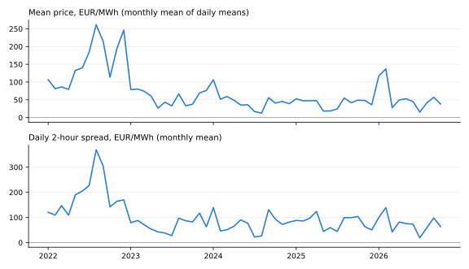
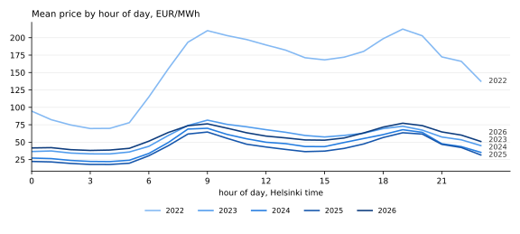
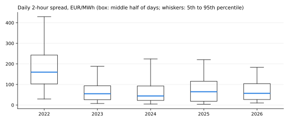
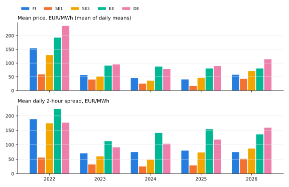
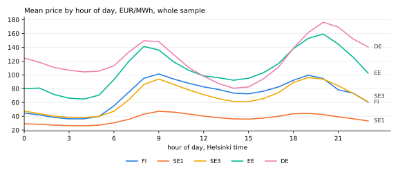
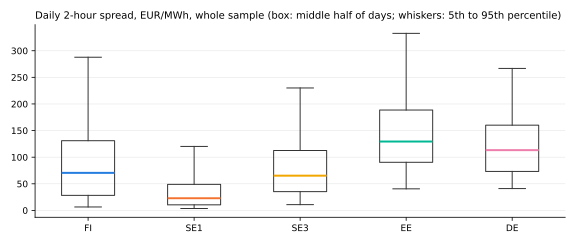

# Check report 03_describe: Describe prices

Written by `code/03_describe.py`. Rerun with `python run_all.py --steps 03`.

Zone **FI**, planning days 2022-01-01 to 2026-10-31 (1765 days, 70872 rows, resolution native), from `data/processed/prices.parquet`. All means are time-weighted: an hour counts as much as four quarter-hours.

**Daily spread** (h hours): the mean price of the most expensive h hours of a day minus the mean price of its cheapest h hours. It is what one battery cycle a day can gain, per MWh, before losses.

## Per year

| year | days | mean | min | max | negative hours | spread 1 h | spread 2 h | spread 4 h |
|---|---|---|---|---|---|---|---|---|
| 2022 | 365 | 154.04 | -2.08 | 861.14 | 27 | 198.65 | 188.80 | 171.80 |
| 2023 | 365 | 56.46 | -500.00 | 777.18 | 467 | 76.31 | 70.36 | 62.38 |
| 2024 | 366 | 45.57 | -20.01 | 1896.00 | 725 | 80.62 | 74.67 | 64.72 |
| 2025 | 365 | 40.47 | -21.39 | 572.20 | 458.75 | 86.45 | 79.77 | 69.21 |
| 2026 | 304 | 57.46 | -10.92 | 654.88 | 56.25 | 81.01 | 74.53 | 65.71 |

Prices in EUR/MWh; spreads are means over the days of the year. The same table: `results/03_yearly.csv`.

## Upper bound: what a battery could earn at most

EUR per kWh of storage per year, for a battery that fills or empties in 1, 2 or 4 hours, makes one full cycle a day, has no losses, and buys and sells at the day-ahead price. Day-ahead prices are known the day before, so the planning itself is realistic; everything else (losses, wear, taxes, fees, the gap between buying and selling prices) only lowers this. Steps 04 and 05 add those.

| year | days | 1-hour battery | 2-hour battery | 4-hour battery |
|---|---|---|---|---|
| 2022 | 365 | 72.51 | 68.91 | 62.71 |
| 2023 | 365 | 27.85 | 25.68 | 22.77 |
| 2024 | 366 | 29.51 | 27.33 | 23.69 |
| 2025 | 365 | 31.55 | 29.12 | 25.26 |
| 2026 | 304 | 24.63 | 22.66 | 19.98 |

Over the full years here (2022-2025), a 2-hour battery could earn at most 37.76 EUR per kWh a year on average (a 10 kWh battery: 378 EUR). Table: `results/03_upper_bound.csv`.

## Facts to recognise: EXPECT next to SEE

The EXPECT column is written for FI; other zones may differ.

| EXPECT | SEE |
|---|---|
| Highest mean price in 2022 (energy crisis) | 2022 (154.04) |
| Largest daily spreads in 2022 | largest mean 2-hour spread: 2022 (188.80) |
| Cheapest hours at night (about 02-05), most expensive in the morning (about 08-09) and evening (about 18-20), Helsinki time | cheapest: 03, 04, 02; most expensive: 09, 19, 08 |
| Negative prices rare in 2022, frequent from 2023 | 2022: 27 h; 2023: 467 h; 2024: 725 h; 2025: 458.75 h; 2026: 56.25 h |
| On 15-minute days, the 1-hour spread from quarter-hours is at least as large as from hourly means (averaging hides the extremes) | 396 days: 80.46 from quarter-hours, 71.36 from hourly means |

## Days with the largest 2-hour spread

Do you recognise these days?

| day | mean | min | max | spread 2 h |
|---|---|---|---|---|
| 2024-01-05 | 886.84 | 111.11 | 1896.00 | 1696.41 |
| 2022-08-08 | 470.01 | 44.98 | 861.14 | 798.63 |
| 2022-08-30 | 455.39 | 18.69 | 799.97 | 768.15 |
| 2022-08-31 | 340.74 | 22.85 | 703.74 | 651.26 |
| 2022-08-26 | 475.00 | 142.06 | 770.00 | 622.55 |
| 2022-08-18 | 457.93 | 37.86 | 667.04 | 618.69 |
| 2022-08-22 | 365.50 | 2.38 | 624.64 | 594.67 |
| 2022-09-01 | 333.00 | 24.94 | 626.59 | 588.23 |

## Figures

Monthly mean price and mean daily 2-hour spread. EXPECT: both high in 2022; spreads stay large after prices fall.

Mean price by hour of day, one line per year (light: early years, dark: late). EXPECT: a night low and morning and evening peaks every year.

Daily 2-hour spread per year. EXPECT: most days well below the mean, a few very large days pulling the mean up.

## Comparing zones

All zones processed with the same choices (`prices_all_zones.parquet` from step 02). Upper bound as above: 2-hour battery, EUR per kWh a year, mean over full years.

| zone | days | mean price | mean 2-hour spread | negative hours a year | upper bound, 2-hour battery | same price as FI |
|---|---|---|---|---|---|---|
| FI | 1765 | 71.25 | 98.41 | 347 | 37.76 | - |
| SE1 | 1765 | 36.48 | 38.02 | 336 | 12.88 | 33 % |
| SE3 | 1765 | 66.63 | 88.61 | 309 | 32.50 | 40 % |
| EE | 1765 | 107.21 | 154.24 | 112 | 57.71 | 39 % |
| DE | 1765 | 122.75 | 128.59 | 373 | 44.66 | 5 % |

'Same price as FI': share of the time when the two zones had the same price, i.e. the cable between them was not full and they were in effect one market.

EXPECT: DE and EE have the highest prices, SE1 the lowest. FI often shares its price with its neighbours (SE1, SE3, EE), almost never with DE (no direct cable). DE's spreads are larger than the Nordic zones' (more solar: midday dip and evening peak); EE's spreads are the largest of all, so EE is the high benchmark for a battery.

Mean price and mean daily 2-hour spread per year and zone. EXPECT: all zones peak in 2022; DE or EE highest and SE1 lowest in every year.

Mean price by hour of day per zone. EXPECT: DE dips at midday (solar) and peaks in the evening; the Nordic zones are flatter.

Daily 2-hour spread per zone. The spread, not the price level, is what a battery earns from.

## Choices in effect

| choice | value | default | first step | reason |
|---|---|---|---|---|
| bidding_zone | FI | FI | 02_process | The research question is about Finland; neighbours and DE (a higher-price benchmark) allow comparison. |
| sample_start | 2022-01-01 | 2022-01-01 | 02_process | Includes the 2022 price crisis; 2025-10-01 starts the 15-minute era. |
| sample_end | 2026-10-31 | 2026-10-31 | 02_process | Last full month before the project started; fixed so reruns agree. |
| planning_day | helsinki | helsinki | 02_process | A Finnish household thinks in local days; 'market' is the market's own day (00-24 Central European time, 01-01 Helsinki). |
| incomplete_days | drop | drop | 02_process | A day with missing prices cannot be planned as a whole; only DE's first days of 2015 and edge days are affected. |
| known_anomalies | keep | keep | 02_process | FI 2023-11-24 (-500, a trader's erroneous bid) was a real price that was paid; 'drop' shows how much one day matters. |
| price_resolution | native | native | 02_process | Keep prices as traded: hourly until 2025-09-30, 15 minutes after. |

## What a person should check

- Per year: the days add up to step 02's count; the means look like the prices you know.
- Upper bound: the order of magnitude is plausible (tens of EUR per kWh a year, not thousands). It is a ceiling, not a forecast.
- Facts: the hours and years match what you know about Finnish prices.
- Figures: the profile has the night low and the two peaks.
